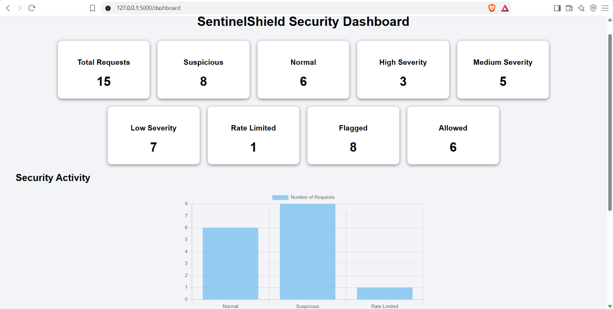
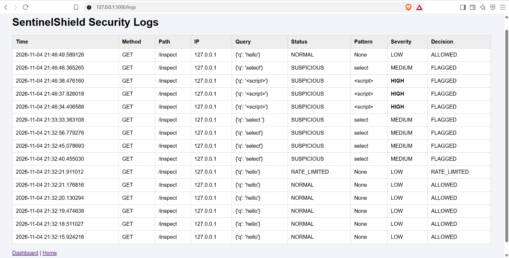
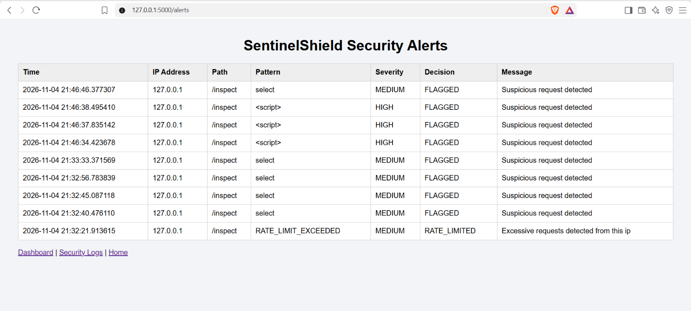
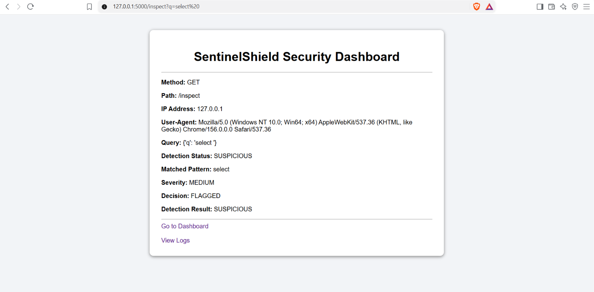

# SentinelShield – Web Security Monitoring System

A Python Flask-based web security monitoring project that inspects HTTP requests, detects suspicious patterns, monitors excessive requests, and generates security alerts.

## About the Project

SentinelShield is an educational web security monitoring application developed using Python and Flask.

It monitors HTTP requests, identifies potentially suspicious activity, classifies security events based on severity, and displays results through a web-based dashboard.

## Features

- HTTP Request Inspection
- Suspicious Pattern Detection
- Security Severity Classification (Low, Medium, High)
- IP-Based Request Monitoring
- Time-Window Rate Limiting
- Automatic Security Event Logging
- Security Alert Generation
- Web-Based Security Dashboard
- Security Activity Chart

##Screenshots

### 1. Security Dashboard


### 2. Security Logs


### 3. Security Alerts


### 4. Request Inspection


## Technologies Used

- Python
- Flask
- HTML
- CSS
- JavaScript
- Chart.js
- JSON

## Installation and Setup

### 1. Clone the Repository

```bash
git clone https://github.com/dikshasharma-25/SentinelSheild
```

### 2. Open Project Directory

```bash
cd SentinelShield
```

### 3. Install Dependencies

```bash
pip install -r requirements.txt
```

### 4. Run the Application

```bash
python app.py
```

### 5. Open in Browser

```text
http://127.0.0.1:5000
```

## Learning Outcomes

- Understanding HTTP requests
- Basic web security monitoring
- Python Flask development
- Pattern matching and detection
- Request rate limiting
- JSON-based security logging
- Dashboard development and data visualization

## Limitations

SentinelShield is an educational prototype. Its detection rules are basic and may produce false positives or miss suspicious requests. It is not intended for production deployment.

## Developer

**BCA Student | Aspiring Cybersecurity Professional**

Interested in Python, Linux, Networking and Cybersecurity.

---

If you find this project interesting, feel free to explore the repository!
